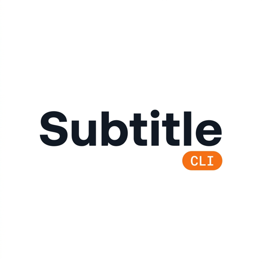

<p align="center">
  
</p>

# Subtitle Generator

[](https://pypi.org/project/subtitle-generator/)
[](https://subtitle.vedgupta.in)
[](https://github.com/innovatorved/subtitle/releases/tag/v4.1.1)
[](https://www.python.org/downloads/)
[](https://opensource.org/licenses/MIT)

Fast, offline AI subtitle generation for any video or audio file — works out of the box on **macOS, Linux, and Windows**.

**Full Documentation:** **[subtitle.vedgupta.in](https://subtitle.vedgupta.in)**

## Install & Run

```bash
pip install subtitle-generator
subtitle video.mp4
```

No compiler or manual setup needed. On first run, `subtitle` automatically downloads the verified prebuilt `whisper-cli` binary, Silero VAD, and the Whisper model for your OS.

## Common Examples

```bash
# Generate SRT subtitles (with Netflix readability formatting)
subtitle video.mp4 --format srt --preset netflix

# Embed soft subtitles into a copy of the video
subtitle video.mp4 --merge --format srt

# Burn word-highlighted Karaoke captions (TikTok / Reels / Shorts)
subtitle reel.mp4 --burn --style karaoke --preset reels

# Batch process a folder of videos
subtitle batch -i ./videos -o ./subs

# Check your environment & GPU acceleration
subtitle doctor
```

## Features

- **Zero-config cross-platform:** Auto-installs prebuilt `whisper-cli` on macOS (Metal), Linux, and Windows.
- **Fast & accurate:** Built-in Silero VAD (`v6.2.0`) eliminates silence hallucinations and speeds up transcription 2–3×.
- **All major formats:** `vtt`, `srt`, `ass` (styled & karaoke), `ttml`, `json`, `csv`, `lrc`, `txt` — emit multiple in one pass.
- **Broadcast & creator ready:** `--preset netflix|bbc|reels`, `subtitle lint`, `subtitle shift`, `subtitle convert`, `subtitle translate`, and `subtitle watch`.
- **Optional extras:** `[yt]` (YouTube/TikTok URLs), `[ffmpeg]` (bundled FFmpeg), `[faster-whisper]` (NVIDIA GPU), `[cloud]` (OpenAI/Groq), `[translate]` (offline Argos).

## Documentation

For the full CLI reference, Python API, models guide, Docker image, and troubleshooting, visit **[subtitle.vedgupta.in](https://subtitle.vedgupta.in)**.

## License

MIT — see [LICENSE](LICENSE).
